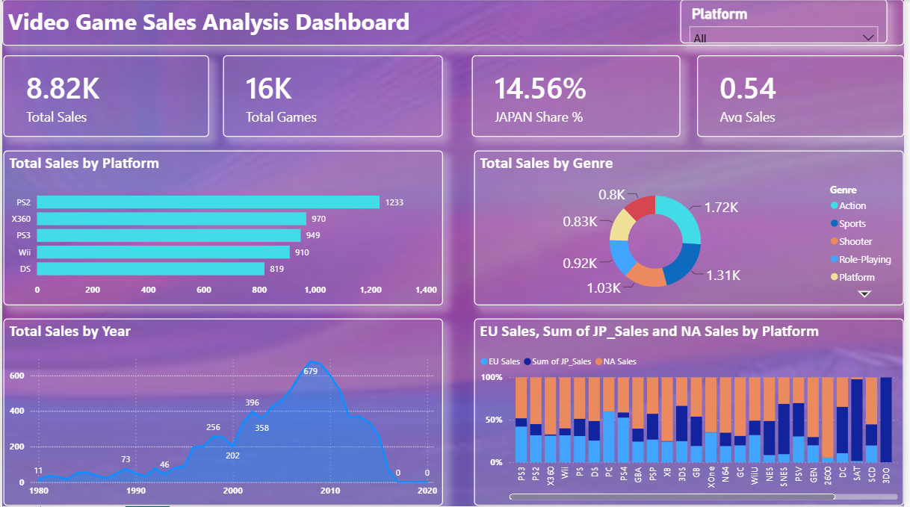

# Global Video Game Sales Analysis | Power BI Dashboard

**Live Portfolio:** https://muhammad-ali-azam.github.io

### 📊 Overview
A single-page comprehensive dashboard analyzing global video game sales across platforms, genres, years, and regions (NA, EU, JP).

### 📑 Dashboard Features (1 Page):
- **KPIs:** Total Sales, Total Games, Japan Share %, Average Sales
- **Total Sales by Platform:** PS2 is top platform with 1,233 sales
- **Total Sales by Genre:** Action is leading genre (1.72K), followed by Sports (1.31K)
- **Total Sales by Year:** Sales peaked in 2008-2009 (679 sales)
- **Regional Sales Analysis:** EU, JP, NA sales breakdown by Platform (100% stacked bar)

### 📁 Files in this Repository
- `4.png` - Complete Dashboard Preview
- `4. Global Games.pbix` - Power BI File

### 🛠️ Tools Used
- Power BI Desktop, Data Visualization, DAX

### 💡 Key Insights
- **8.82K** Total Sales | **16K** Total Games
- **14.56%** Japan Market Share | **0.54** Average Sales per Game
- **PS2** is the most successful platform (1,233 sales) followed by X360 (970)
- **Action & Sports** are the most popular genres
- **2008 was the peak year** for video game sales (679)
- **Platform Filter:** Interactive filter for Platform analysis

---
*Developed by Muhammad Ali Azam | Data Analyst from Multan*
